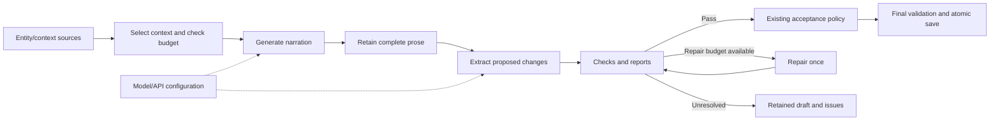

# Node-based story workflows — next project milestone

Decision date: October 21, 2026. **All five phases are complete within the supported built-in scope.** This evolves the existing Storyweaver TypeScript/SvelteKit engine. [Phase 1](NODE_WORKFLOW_PHASE_ONE.md) records contracts; [phase 2](NODE_WORKFLOW_PHASE_TWO.md) implements all passage modes and durable recovery; [phase 3](NODE_WORKFLOW_PHASE_THREE.md) adds read-only workflow inspection, supported retries and local history controls; [phase 4](NODE_WORKFLOW_PHASE_FOUR.md) connects a location-first map to existing story/setup editors; [phase 5 closeout](NODE_WORKFLOW_PHASE_FIVE_COMPLETE.md) finishes editable built-ins, node/source settings, visual groups, reusable presets and the user-requested passage checkpoints/forks.

**Final verification:** 508 automated tests, clean Svelte checks, successful production build (existing size advisory) and nine isolated production browser suites. An author can configure supported model/source/repair alternatives, save/reopen them, use the grouped canvas or typed lists, archive/restore/copy presets and recover failed branches. Every accepted passage retains its workflow and historical world/context/prose for independent forks and ZIP portability. Default call/context budgets, mandatory validation and atomic recovery remain authoritative. Older passages cannot acquire inferred historical state. The [closeout](NODE_WORKFLOW_PHASE_FIVE_COMPLETE.md) maps each gate to evidence and separates future expansion from completed scope. The sections below retain the approved delivery plan.

The prior application checkpoint is [the recovery review](PASSAGE_RECOVERY_REVIEW.md): 366 automated tests, clean type/build checks and four isolated browser suites. Phase-1 verification is recorded separately in the [implementation notes](NODE_WORKFLOW_PHASE_ONE.md); historical browser results are not new workflow verification.

## Intended outcome

Make the generation process visible and configurable through nodes: model/API connections, character/location/item/lore context, generation stages, branching checks, bounded repair and acceptance. Inspect each stage's actual inputs, outputs, status and errors; retain usable prose and rerun supported downstream work when a check fails.

Pair this with a location-first world map. Begin with location nodes, expand into sublocations and connected people/possessions, then into nested containers and other related records. Selecting an entity opens its existing validated editor. The [location-map design](LOCATION_NODE_MAP_IDEA.md) supplies the detailed relationship semantics.

The world map describes fictional relationships. The workflow graph describes processing dependencies. Both reference the same authoritative records; a visual edge must have an explicit meaning.

## Architecture decision

Build an isolated workflow module within this project, using adapters around the existing engine. Reuse working code and regression coverage directly. A separate application rewrite using this project only as reference is not the chosen direction.

| Existing component | Planned responsibility |
| --- | --- |
| `server/llm.ts`, connection settings | Server-side model/API node adapter; configuration references keep credentials out of graphs |
| Context builder, scene/entity selection, extraction context, token budget | Typed source/context nodes with task-specific selection and required constraints |
| `server/story-generation.ts` | Operations to extract from hardcoded orchestration into built-in node runners |
| Inventory review, effect schemas, fact pins and canonical validation | Check results, repair inputs and mandatory final validation |
| Jobs, diagnostics and retained passages | Existing lifecycle/recovery foundations, extended with authoritative per-node run artifacts |
| Repository, passage commit and opening preparation | The final atomic save boundary |
| Record/setup editors | Entity inspector/editor reached from map nodes |

These are reuse boundaries to investigate, not a claim that the modules are already independent plug-ins. Routes, generation and persistence still have application-specific coupling.

## Initial node vocabulary

| Node family | Inputs and outputs | Meaning |
| --- | --- | --- |
| World/source selection | Saved source, explicit entity IDs or selection criteria → typed references/snapshots | Characters, places, possessions, relationships, lore, memory and scene direction; no independent mutable copies of canon |
| Model/API profile | Local configured connection reference + supported request settings → model configuration | A generation/check node selects its model explicitly; the default uses today's configured text connection |
| Context assembly | Source selections, task, pins/preferences, budget → scoped messages and scope/token report | Structured context is the text-model equivalent of conditioning; graph visibility does not automatically include a record |
| Generation | Model configuration + scoped input → narration, proposed effects or another supported draft | Initially expose the existing narration and extraction operations |
| Checks | Draft/proposal + relevant saved facts → structured pass/issues/blocked result | Deterministic schema/reference/count/pin checks and the existing targeted model consistency review stay distinguishable |
| Branch/repair | Check report + remaining attempt budget → bounded repair or retained draft | Reuse existing one-repair behavior; unresolved issues preserve the draft for author correction |
| Acceptance/save | Complete validated proposal + current source revision + existing acceptance policy → atomic committed result | Normal validated generation retains its current save behavior; recovered proposals still require explicit review/acceptance |

Built-in nodes may be extended through trusted project code. An arbitrary third-party plug-in system or user-supplied executable scripts is outside this milestone.

Illustrative default flow; the phase-1 fixture must also account for the current preflight and conditional length-expansion behavior:

Model/API configuration supplies an existing connection; it does not itself make a request. Explicit generation/model-review operations make the calls. The repair edge is bounded, and acceptance continues to distinguish normal validated generation from author-reviewed recovered proposals.

## Delivery sequence

### 1. Contracts and a default graph — first implementation task

- Define versioned workflow/node definitions, typed ports, node registration, source bindings and run/artifact contracts.
- Create a default workflow fixture describing current generation behavior, including context/extraction preflight, conditional length expansion, retained prose, extraction, checks, one bounded repair and commit.
- Document which existing function owns each operation and which inputs each operation needs. Capture opening, continuation and latest-replacement differences explicitly.
- Keep graph definitions, canvas layout and run artifacts separate from canonical story records. Choose storage boundaries before adding persistence.
- Establish characterization checks using isolated data and deterministic provider responses; preserve the historical Brasswater/ranch fixtures and current measured baselines.

**Ready when:** the default graph is structurally validated, port/connection errors are clear, its operations map to existing code, and the run/artifact contracts define stale results, retry and acceptance without requiring a new provider call or changing a saved story.

### 2. Executable runner with current-behavior parity

**Implemented:** opening, continuation and latest replacement, durable attempts/artifacts/provider bodies, effects-only retry, reviewed atomic acceptance, complete-content recovery and post-commit memory/HTTP integration. See [implementation and verification](NODE_WORKFLOW_PHASE_TWO.md).

- Implement a dependency runner and adapters for the default graph. Begin with continuation, then opening and latest replacement before switching the normal generation entry points.
- Serialize conflicting work per story/setup initially. Conditional branches evaluate the needed work; neither a graph edge nor a retry should duplicate an already completed model request accidentally.
- Persist complete authoritative stage outputs separately from scrubbed/truncated diagnostics. Preserve node implementation/workflow versions, relevant source/configuration fingerprints and attempt provenance.
- Support cancellation, interrupted runs, request deduplication and explicit restart recovery. Waiting for author acceptance must not hold an active provider job or story lock indefinitely.
- Keep the current path available until parity is demonstrated. Do not run old and new pipelines against live providers merely to compare them; use captured or deterministic outputs for equivalence checks.

**Ready when:** opening, continuation and latest replacement preserve prose/effects/memory/recovery behavior, reject stale results and commit once under repeated requests. Provider-call counts, context budgets, cancellation and failed-check recovery match the existing path for equivalent inputs.

### 3. Workflow canvas, inspection and supported reruns

**Implemented:** read-only dependency diagram and keyboard/list inspector, current-source and superseded-check explanations, existing effects-only recovery/acceptance controls, complete-content promotion and guarded history cleanup. See [phase-3 verification and limits](NODE_WORKFLOW_PHASE_THREE.md). Editable canvas interactions remain phase 5.

- Display the default graph with typed connections and clear queued/running/completed/blocked/failed/interrupted states.
- Open a node inspector for resolved inputs, outputs, selected entity references, token estimates, actual provider usage when available, issues and source provenance.
- Provide supported downstream retries from retained artifacts. Changing guidance or saved facts must not silently accept an older checked proposal.
- Explain stale artifacts and which downstream work must be repeated before acceptance. Preserve useful prose as a separate readable/copyable draft.
- Provide keyboard controls and a list/inspector alternative for small screens. Keep ordinary reading and editing available without requiring canvas use.

**Ready when:** the sugar-cube failure can be understood, corrected and retried through visible stages without regenerating the prose, and reload/cancellation/another-window cases remain recoverable.

### 4. Location-first world map and existing editors

**Implemented:** collapsed saved location trees, typed presence/storage/containment and separate reference links, search/scene focus, existing story/setup editors with explicit saves and stale-draft guards, browser-local layout and explicit scene hints. See [phase-4 verification](NODE_WORKFLOW_PHASE_FOUR.md).

- Start collapsed at root locations; search or focus the current scene and expand downward into sublocations, people, possessions and containers.
- Label containment, current presence, immediate storage and related lore/tasks separately. Support multiple references to one entity without creating duplicate canonical records.
- Open existing setup/record editors beside the selected node, preserving explicit saves, unsaved-draft guards, stale revision checks and manual recovery invalidation.
- Treat dragging as layout changes. Changing physical placement or a relationship requires an explicit validated authoring action.
- Add source selections to a workflow or scene brief through a separate action; inspection alone neither includes them in the prompt nor grants viewpoint knowledge.

**Ready when:** the Brasswater/ranch fixtures can be explored and edited through a focused map without expanding all inventory, leaking hidden knowledge into model context or changing unrelated records. Keyboard/list access remains usable.

### 5. Editable built-in workflows and reusable presets

**Complete:** [pass 1](NODE_WORKFLOW_PHASE_FIVE.md) provides list/port authoring and versioned presets; [pass 2](NODE_WORKFLOW_PHASE_FIVE_PASS_TWO.md) provides compiled explicit execution; [pass 3](NODE_WORKFLOW_PHASE_FIVE_PASS_THREE.md) provides portable passage workflow/world checkpoints and story forks; the [final pass](NODE_WORKFLOW_PHASE_FIVE_COMPLETE.md) adds model/source configuration, trusted retain-versus-repair branching, typed canvas editing, browser-local presentation groups and preset lifecycle/revision copies. The supported subset retains all mandatory checks; default generation and final save rules remain intact. Multiple independent API profiles, arbitrary control flow/scripts and executable subgraph groups remain separate expansion.

- Allow supported built-in nodes to be added/configured/connected, with typed ports, required inputs and clear invalid-graph errors before execution.
- Expose explicit model choices, context sources, configurable check branches and bounded repair/recovery paths. No automatic provider fallback or new default model stage is implied.
- Support node groups/presets and versioned workflow JSON with missing source/model bindings reported before execution. Exported definitions contain no API keys or copied private connection credentials.
- Validate execution cycles and retry limits; initial user graphs use supported dependency and bounded-control patterns rather than unrestricted loops.
- Keep authoritative final validation inside the save boundary. An experimental graph can produce a draft/report; disconnecting a visible check cannot bypass save invariants.

**Ready when:** an author can configure a supported alternative workflow, save/reopen it, inspect a failed branch and recover it, while the default workflow and ordinary reader still behave correctly.

## Runtime and data rules

- **Canon stays authoritative.** Node omission does not authorize deleting/changing omitted records. Graph outputs remain proposals until the full atomic commit succeeds.
- **Reuse is explicit.** Deterministic artifacts may be reused when relevant inputs and implementation versions match. Model outputs are retained results of particular attempts; identical request settings do not make a fresh model call deterministic.
- **Saved-fact corrections preserve the existing recovery option.** An explicit effects-only retry can reuse immutable retained prose with its original provenance, re-extract against current saved facts and invalidate older proposals/checks. This must not force a narration restart merely because the source revision changed. Changed written history/invalid replacement baselines retain today's refusal rules unless separately designed and verified.
- **Mandatory checks remain server-side.** Complete references, ownership/storage graphs, finite quantities/supply modes, pins/preferences, evidence and latest-only replacement must validate at acceptance. Workflow branches do not create alternate story timelines or partial-effect commits.
- **Scoping remains an acceptance requirement.** Preserve deterministic task-specific selection, compact references, physical paths, viewpoint knowledge distinctions and the current context-window policy. Do not solve graph complexity by sending the visible world map to the model or increasing automatic call counts.
- **Secrets remain server-side.** A model node stores a configured connection reference and supported settings. Inspection/export must not reveal private keys.
- **Preserve existing saves and boundaries.** Keep canonical story/setup/media archives working; do not silently replace libraries/settings or reset user data. Version new workflow records independently. Portable run-artifact export and broad save migrations require separate decisions.
- **Separate evidence.** Record deterministic equivalence, browser behavior, token/call measurements and live-model quality independently. The last checkpoint's 366 passing tests are a baseline, not proof that the future runner works.

## Acceptance and rollout gate

Before replacing normal orchestration, verify:

1. Existing canonical inventory, lore, pins, content preferences, memory, illustration associations and archive contracts still pass their regression checks.
2. Opening/continuation/replacement results and provider-call budgets match the existing default path with controlled responses; replacement uses the correct pre-event canon and current author constraints.
3. Failed extraction/review, malformed output, cancellation, restart and late source edits retain useful artifacts while keeping accepted prose/canon unchanged.
4. Duplicate requests, repeated acceptance and concurrent windows cannot create duplicate passages or apply stale effects. Missing connections, unknown nodes/types and invalid control flow fail before provider work.
5. Scope/request audits preserve historical snapshots and distinguish narration/extraction/review costs. Run any real-model probes separately with isolated data and bounded requests.
6. Canvas/map interactions have production browser coverage for focus, unsaved edits, filtering, loading failure/retry and narrow screens; core authoring remains available through existing/list interfaces.

The milestone is complete when the default pipeline runs through the new engine, stages are inspectable/recoverable, supported built-in workflows are editable, the connected location map opens existing editors, and the gates above pass. It does not require a general-purpose plug-in marketplace, arbitrary scripts, story forks, automatic illustration expansion or a new application repository.

## Starting point for the next implementation turn

**The five-phase milestone is complete.** Preserve its compiler, source/model ceilings, typed/list access, checkpoint portability and recovery gates in future changes. Further product work follows the user's next direction; optional expansions and sustained-model/scoping evaluation are listed in the [closeout](NODE_WORKFLOW_PHASE_FIVE_COMPLETE.md). Do not invent another required Phase 5 pass or resume its already-completed implementation list. Keep default budgets, final validation, source freshness, explicit saves and atomic recovery. Arbitrary plugins/scripts remain deferred.
