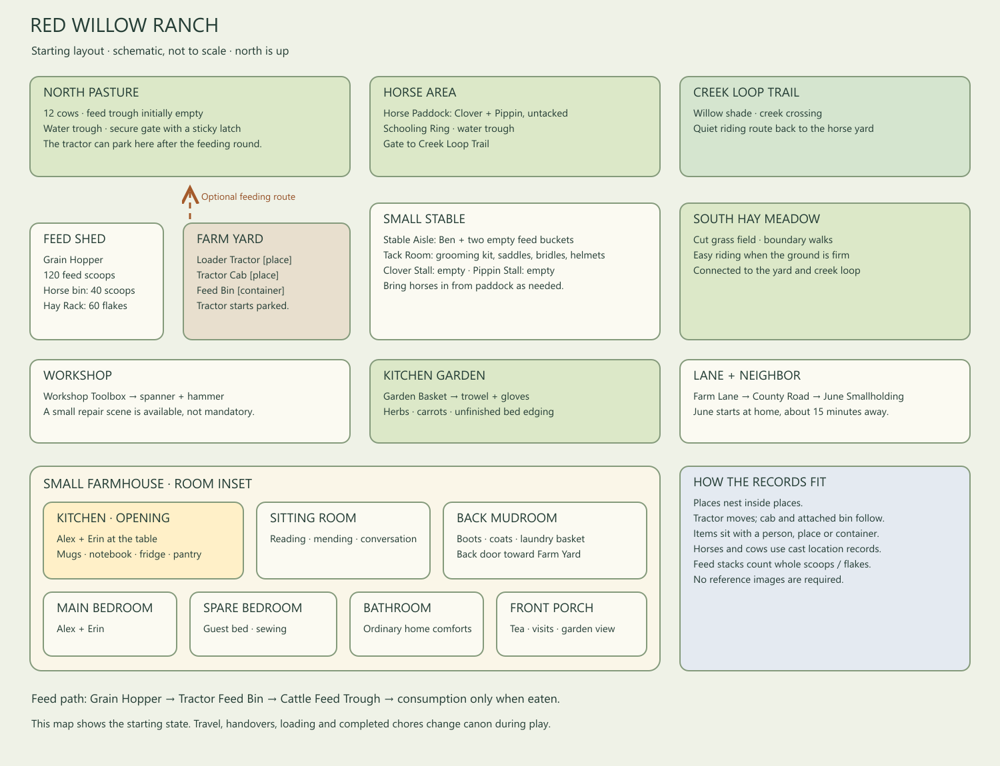

# Red Willow Ranch: starting layout



The diagram shows approximate zones and a farmhouse inset. It is not to scale. Containment is explicit in the setup; roads and paths are described connections, not a route-finding simulation.

## Place hierarchy

```text
Red Willow Ranch
├── Small Farmhouse
│   ├── Farmhouse Kitchen       ← Alex + Erin; opening scene
│   ├── Sitting Room
│   ├── Main Bedroom
│   ├── Spare Bedroom           ← guest bed + sewing/paperwork space
│   ├── Farmhouse Bathroom
│   ├── Back Mudroom            ← back door toward the yard
│   └── Front Porch
├── Farm Yard
│   ├── Feed Shed
│   ├── Workshop
│   └── Loader Tractor          ← movable PLACE, parked in yard
│       └── Tractor Cab         ← child PLACE; empty at the opening
├── North Pasture               ← Cattle Herd: twelve cows
├── South Hay Meadow
├── Horse Yard
│   ├── Small Stable
│   │   ├── Stable Aisle        ← Ben
│   │   ├── Tack Room
│   │   ├── Clover Stall        ← empty
│   │   └── Pippin Stall        ← empty
│   ├── Horse Paddock           ← Clover + Pippin, untacked
│   └── Schooling Ring
├── Kitchen Garden
├── Creek Loop Trail
└── Farm Lane

County Road                    ← separate public place
June Smallholding              ← separate property; June starts here
```

The farmhouse opens toward the yard through the mudroom and toward the lane/garden through the porch. The yard connects shed, workshop, pasture gate and horse area. The stable and paddock connect to the ring and creek loop. June's home is about fifteen minutes away on foot via the lane and county road; she is not automatically present in ranch scenes.

## People and animals

| Record | Starting place | Role |
| --- | --- | --- |
| Alex Morrow, 38 | Farmhouse Kitchen | Rancher; usual rider of Pippin |
| Erin Morrow, 36 | Farmhouse Kitchen | Partner, gardener; usual rider of Clover |
| Ben Cooper, 27 | Stable Aisle | Part-time helper, learning the horse routines |
| June Calloway, 56 | June Smallholding | Neighbor, friend and experienced leisure rider |
| Clover, 9 | Horse Paddock | Chestnut mare with flaxen mane and white blaze |
| Pippin, 12 | Horse Paddock | Bay gelding with a small white star |
| Cattle Herd | North Pasture | Twelve adult beef cows, represented as one group |

Animal records allow the story to preserve locations and behaviour without treating animals as cargo. They do not speak. A horse's rider and the horse each move to the destination; the rider is not located “inside” the horse.

## Equipment, containers and stock

An indented item is physically held by the place, person or container above it. These are storage/custody paths; they do not encode legal title.

```text
Feed Shed [place]
├── Grain Hopper [container]
│   └── Cattle Feed: 120 whole level scoops
├── Level Feed Scoop
├── Horse Feed Bin [container]
│   └── Horse Pellets: 40 whole level scoops
└── Hay Rack [container]
    └── Hay Flakes: 60 whole flakes

Loader Tractor [place, in Farm Yard]
├── Tractor Cab [place]
└── Tractor Feed Bin [item container, empty]

North Pasture [place]
├── Cattle Feed Trough [container, empty]
├── Pasture Water Trough [supplied; water volume not counted]
└── North Pasture Gate [closes securely; latch is awkward]

Stable Aisle [place]
├── Clover Feed Bucket [container, empty]
└── Pippin Feed Bucket [container, empty]

Tack Room [place]
├── Grooming Kit [container]
│   ├── Wooden Grooming Brush
│   ├── Curry Comb
│   └── Hoof Pick
├── Clover Trail Saddle + Clover Bridle [separate items]
├── Pippin Riding Saddle + Pippin Bridle [separate items]
├── Clover Halter and Lead [one set]
├── Pippin Halter and Lead [one set]
├── Charcoal Riding Helmet [Erin's]
└── Green Riding Helmet [Alex's]

Horse Paddock [place]
└── Horse Water Trough [supplied; water volume not counted]

Workshop [place]
└── Workshop Toolbox [container]
    ├── Adjustable Spanner
    └── Claw Hammer

Farmhouse Kitchen [place]
├── Kitchen Table [surface container]
│   ├── Alex Blue Mug
│   ├── Erin Cream Mug
│   └── Household Notebook
├── Refrigerator [container]
│   └── Eggs: 10
├── Pantry Cupboard [container]
│   └── Bread Slices: 12
├── Kitchen Kettle
└── Recipe Book

Back Mudroom [place]
├── Laundry Basket [container; incidental laundry not itemized]
├── Alex Work Boots
└── Erin Yard Boots

Kitchen Garden [place]
└── Garden Basket [container]
    ├── Garden Trowel
    └── Gardening Gloves [one pair]

Sitting Room [place]
└── Evening Reading Book
```

Clothing worn at the opening is in character wardrobe fields. Boots in the mudroom are separate unworn items. Routine furniture, household staples and fluids are mostly described background; this keeps the world useful without itemizing every spoon or cup of water.

## Example feeding state changes

| Step, if actually narrated | State to expect |
| --- | --- |
| Start | Hopper: 120 scoops; tractor bin and trough empty; tractor in yard |
| Load exactly 12 scoops | Hopper: 108; a 12-scoop feed stack held by Tractor Feed Bin |
| Board and drive to pasture | Alex in Tractor Cab; cab inside tractor; tractor inside North Pasture; bin still attached to tractor |
| Pour all 12 scoops into trough | That stack's holder becomes Cattle Feed Trough; pouring alone consumes nothing |
| Cows actually eat 4 scoops | Trough stack: 8; hopper: 108; 4 consumed |
| Park, climb down and walk home | Alex returns to the kitchen; tractor, cab and attached bin remain in North Pasture |

The initial import contains only the **start** state. The remaining rows are an example to check against what is actually narrated, not prewritten events or a fixed feeding requirement. Whole scoops/flakes are simple inventory units. Vehicle movement changes its containing place; it does not require giving the tractor to the location as an item.
